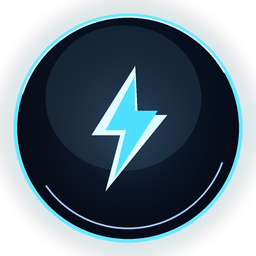

  

<h1 align="center">VGN Orb</h1>

  A lightweight Windows tray HUD for VGN mice and keyboards. 
  轻量、只读、不打扰的 VGN 设备电量悬浮窗。

  
  
  
  
  

VGN Orb 是一个常驻系统托盘的 Windows 小工具。鼠标移动到屏幕右上角时，它会弹出一块 Dynamic Island 风格的设备卡片，显示 VGN 鼠标/键盘的电量和连接状态；移开后自动收回。

它直接通过 HID 读取设备数据，不需要安装厂商驱动，也不会修改设备配置。

> 非 VGN 官方项目。协议来自公开网页驱动行为的逆向整理；仓库不包含厂商固件或厂商代码。

[Features](#features) · [Screenshots](#screenshots) · [Supported devices](#supported-devices) · [Getting started](#getting-started) · [Usage](#usage) · [Configuration](#configuration) · [Architecture](#architecture) · [Testing](#testing) · [License](#license)

  

## Features

- **Top-right hover HUD**：20 × 20 热区，鼠标进入后弹出，移出后自动收回。
- **Single / dual device cards**：单设备 300 × 100，双设备 300 × 200，最多显示 2 台。
- **Dynamic Island-style motion**：小胶囊弹性展开成卡片，内容延迟淡入；收回时反向收起。
- **Click-through overlay**：HUD 和热区都点击穿透，不抢焦点、不挡操作。
- **Real HID battery reads**：基于 HidSharp 直接读取鼠标和键盘 HID 报告。
- **Independent polling**：每台设备有独立连接和轮询生命周期，一台离线不影响另一台。
- **Tray controls**：刷新全部、重新发现、断开全部、始终置顶和退出。
- **Mock fallback**：没有真实设备时自动使用模拟设备，方便开发和预览。
- **Read-only by design**：不发送未经实物验证的设备写命令。

### HUD design

- 贴住主屏右上角，仅左下角保留 30px 圆角，其余三角为直角。
- 纯黑背景 #000000，霓虹绿电量环 #3CFF00。
- 字体优先 GeoSansLight，缺失时回退 Segoe UI。
- 单设备使用“单设备”布局，不会套用双设备行。
- 100% 电量会自动适配字号，避免被文本框裁切。

## Screenshots

| 单设备 | 双设备 |
| --- | --- |
|  |  |

[打开弹出/收回动画 GIF](docs/hud-spring.gif)

弹出时先把右上角的小胶囊从 76 × 48 弹性撑开到目标尺寸（600ms，轻弹簧关键帧），内容在 110ms 后淡入；收回时缩回 76 × 48（230ms，BackEase）。收回过程中鼠标重新进入，会从当前尺寸反向弹回。

## Supported devices

| 设备 | VID / PID | 连接方式 | 验证结果 |
| --- | --- | --- | --- |
| VGN DragonFly F1 SE | 0x3554 / 0xFB51 | USB 有线 | 100%、充电中、4182 mV、FW 313 |
| VGN DragonFly F1 SE | 0x3554 / 0xFB50 | 2.4G 接收器 | 100% |
| VGN V98Pro V4 8K | 0x391D / 0x200B | USB 有线 | 100%、充电中、FW 23.2.0 |
| VGN V98Pro V4 8K | 0x391D / 0x2A03 | 2.4G 接收器 | 99% |

已加入但未在本机做实物验证的兼容映射：

- F1 SE 备用有线 PID：0x3554:0xF511
- V98Pro V4 TIMI / 接收器 PID：0x391D:0x201C、0x391D:0x2A0A

协议帧、校验算法和抓包回归见 [docs/vgn-hid-protocol.md](docs/vgn-hid-protocol.md)。

## Requirements

- Windows 10/11
- [.NET 10 SDK](https://dotnet.microsoft.com/download)（仅从源码构建时需要）
- 支持的 VGN HID 设备；没有时自动回退模拟设备

## Getting started

从源码构建：

    git clone https://github.com/Pimeng/VGNOrb.git
    cd VGNOrb
    dotnet restore VGNOrb.sln
    dotnet build VGNOrb.sln -c Release
    dotnet run --project src/VGNOrb.Avalonia/VGNOrb.Avalonia.csproj

Release 输出：

    src/VGNOrb.Avalonia/bin/Release/net10.0/VGNOrb.exe

VGN Orb 没有主窗口。启动后它只出现在系统托盘，等待鼠标进入右上角热区。

## One-click build

Windows 下双击或在终端执行：

    .\build.cmd

脚本会自动执行 restore、Release build、29 个测试，并生成：

- `VGNOrb-<version>-win-x64.zip`：AOT 原生主包，默认生成，不需要 .NET Runtime
- `VGNOrb-<version>-win-x64-portable.zip`：开箱即用，自带运行时，不需要 .NET Runtime
- `VGNOrb-<version>-win-x64-runtime-required.zip`：需要 .NET 10 Desktop Runtime

GitHub Release 的资产名使用 ASCII，避免中文字符在 upload API 中被规范化导致文件名丢失。

输出目录：

    artifacts\build-<version>\

可选参数：

    .\build.cmd -Version 1.1.0
    .\build.cmd -NoAot
    .\build.cmd -SkipTests

也可以直接运行 PowerShell 脚本：

    pwsh -File .\build.ps1 -Version 1.1.0

## Usage

| 操作 | 行为 |
| --- | --- |
| 鼠标移到右上角 | 展开设备 HUD |
| 鼠标移出右上角和 HUD | 350ms 后收回 |
| 托盘右键 → 设备 (N/2) | 查看当前设备 |
| 托盘右键 → 刷新全部电量 | 刷新所有已连接设备 |
| 托盘右键 → 重新发现并连接 | 重新发现设备并重建连接 |
| 托盘右键 → 断开全部设备 | 释放全部设备 |
| 托盘右键 → 始终置顶 | 切换 HUD 置顶 |
| 托盘右键 → 退出 VGN Orb | 关闭应用 |

HUD 本身点击穿透；设备操作从托盘菜单完成。

## Configuration

配置文件：

    %APPDATA%\VGNOrb\settings.json

    {
      "alwaysOnTop": true,
      "autoConnectDevice": true,
      "preferHardware": true,
      "pollIntervalMilliseconds": 5000
    }

| 配置项 | 默认值 | 说明 |
| --- | --- | --- |
| alwaysOnTop | true | HUD 是否置顶 |
| autoConnectDevice | true | 启动后自动发现并连接设备 |
| preferHardware | true | 优先真实设备；没有时回退模拟设备 |
| pollIntervalMilliseconds | 5000 | 轮询间隔，限制在 1000–60000 毫秒 |

## Architecture

    VGNOrb.sln
    ├─ src/
    │  ├─ VGNOrb.Core/                 # 无 UI 依赖
    │  │  ├─ Devices/                  # IDevice / 发现接口 / 数据模型 / Mock
    │  │  ├─ Polling/                  # 独立轮询
    │  │  └─ Configuration/            # JSON 配置 + source generation
    │  ├─ VGNOrb.Devices.Vgn/          # HidSharp + 真机 HID 适配器
    │  │  ├─ VgnJmProtocol.cs          # F1 SE 鼠标协议
    │  │  ├─ VgnKeyboardProtocol.cs    # V98Pro V4 键盘协议
    │  │  └─ Vgn*Device*.cs
    │  └─ VGNOrb.Avalonia/             # Avalonia 12 组合根
    │     ├─ App.cs / AppHost.cs       # 生命周期、配置和自动连接
    │     ├─ ViewModels/
    │     │  ├─ OrbViewModel.cs        # 最多 2 台设备编排
    │     │  └─ DeviceTileViewModel.cs # 单设备状态与轮询
    │     ├─ Views/
    │     │  ├─ DeviceHudWindow.cs     # 300x100 / 300x200 HUD 和动画
    │     │  ├─ DeviceRow.cs           # 单设备行
    │     │  └─ HotCornerWindow.cs     # 20x20 右上角热区
    │     ├─ Services/
    │     │  ├─ DeviceHudController.cs # 悬停显示/隐藏和点击穿透
    │     │  ├─ TrayIconService.cs     # Avalonia TrayIcon / NativeMenu
    │     │  └─ AutomaticDeviceDiscoveryService.cs
    │     └─ Controls/BatteryRing.cs
    └─ tests/
       └─ VGNOrb.Core.Tests/

工作流：

1. 两个发现源（鼠标 / 键盘）收集受支持设备。
2. 按设备 ID 去重，最多保留 2 台。
3. 每台设备拥有独立的 DevicePollingService。
4. 设备状态推送到 DeviceTileViewModel，由 OrbViewModel 汇总。
5. DeviceHudController 根据 20 × 20 热区和当前设备数控制 HUD。

## Tech stack

- C# / .NET 10
- Avalonia 12.1.6
- SkiaSharp / HarfBuzz（由 Avalonia 渲染后端使用）
- CommunityToolkit.Mvvm 8.4.2
- HidSharp 2.6.4
- System.Text.Json source generation（AOT-safe settings）

## Native AOT

Avalonia 版本支持 Native AOT，发布命令：

    dotnet publish src/VGNOrb.Avalonia/VGNOrb.Avalonia.csproj ^
      -c Release -r win-x64 -p:PublishAot=true ^
      -p:NuGetAudit=false -p:SuppressTrimAnalysisWarnings=true ^
      -p:PublishSingleFile=true -p:IncludeNativeLibrariesForSelfExtract=true

当前产物约 39 MB（含 Skia/ANGLE/HarfBuzz 原生库），不需要安装 .NET Runtime。HidSharp 仍会产生 trim warning，发布后应重新验证真实设备连接。

构建脚本默认生成 AOT 包；如需跳过 AOT 只生成另外两个版本：

    .\build.cmd -NoAot

## Testing

    dotnet test tests/VGNOrb.Core.Tests/VGNOrb.Core.Tests.csproj -c Release

当前 **29** 个测试，覆盖：

- F1 SE 鼠标真机抓包：在线、电量、固件、校验和。
- V98Pro V4 键盘真机抓包：电量、固件、校验和。
- 模拟设备连接状态、取消连接、参数读写。
- 轮询持续运行、异常隔离和停止。
- 设备发现与异常端点。
- JSON 配置往返、损坏文件回退和参数归一化。

## Limitations

- 最多同时展示 2 台设备。
- 只实现读取；没有独立验证的设备写入能力。
- 当前只验证了 F1 SE 和 V98Pro V4 的实机连接。
- 不处理 Bootloader、固件升级或厂商私有配置格式。
- 仅支持 Windows。
- GeoSansLight 字体不随仓库分发，缺失时回退 Segoe UI。

## Fonts

HUD 优先使用本机安装的 **GeoSansLight**，缺失时回退 Segoe UI。字体文件没有随本仓库或发布物分发。

GeoSansLight 由 Manfred Klein 创建。其条款允许私人、慈善和商业使用；商业盈利时建议向无国界医生等组织捐款。但**未经许可不能把字体文件打包进任何产品、合集、光盘或发布物**，无论商业还是 shareware。

因此本项目只按字体名调用用户本机已安装的字体。若要把字体随安装包分发，必须先取得 Manfred Klein 的明确许可。条款来源和完整说明见 [THIRD-PARTY-NOTICES.md](THIRD-PARTY-NOTICES.md)。

MIT 许可只覆盖本项目的代码和文档，不覆盖 GeoSansLight 字体本身。

## Contributing

欢迎提交 issue 和 pull request。

- 提交信息使用 [Conventional Commits](https://www.conventionalcommits.org/)：feat(ui): ...、fix(devices): ...、docs: ...。
- 提交前运行 Release 构建、全部测试和 dotnet format。
- VGNOrb.Core 不应引入 UI 框架依赖。
- 新设备或新协议请补充抓包回归测试，不要提交未验证的写命令。
- 不要复制厂商代码或固件。

## License

本项目源代码与文档采用 **MIT License**，详见 [LICENSE](LICENSE)。第三方组件许可见 [THIRD-PARTY-NOTICES.md](THIRD-PARTY-NOTICES.md)。

VGN Orb 是非官方项目，与 VGN 官方无关联。VGN 及相关产品名称归其各自所有者所有。仓库不包含厂商固件、厂商代码或厂商配置文件。

## Acknowledgements

- [SmartIsland](https://github.com/agupta07505/SmartIsland) — pill → card 形变参考
- [Physics-Toast](https://github.com/vorojar/Physics-Toast) — 弹簧和打断连续性参考
- [Avalonia](https://avaloniaui.net/) — cross-platform XAML UI
- [HidSharp](https://github.com/IntergatedCircuits/HidSharp) — HID 传输
- [CommunityToolkit.Mvvm](https://github.com/CommunityToolkit/dotnet) — MVVM
- [GeoSansLight](https://www.dafont.com/geo-sans-light.font) — Manfred Klein

