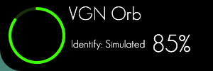
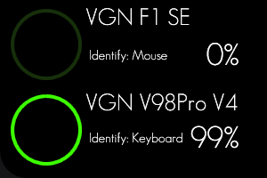
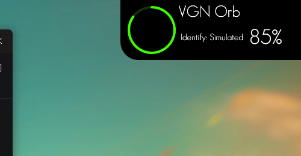

# VGN Orb

一个可以独立运行的 Windows 多设备悬浮显示工具：常驻托盘，鼠标移动到屏幕右上角时显示设备 HUD，移开自动隐藏。支持单设备和双设备两种布局，最多同时显示 2 台设备。





## 设计复刻

UI 按即时设计画布中的两个分组通过 MCP 读取后复刻：

- `单设备` 分组：300 × 100，单行卡片。
- 双设备分组：300 × 200，两行卡片。
- 卡片贴住屏幕右上角：仅左下角保留圆角 30，其余三角为直角。
- 纯黑背景 `#000000`。
- 霓虹绿电量环 `#3CFF00`。
- 字体：GeoSansLight（设计同款，本机已安装；缺失时回退 Segoe UI）。
- 字号：设备名 26，Identify 15，电量 34；在 100% 缩放下为提高边缘清晰度略作调整。
- 开启 ClearType / ClearTypeHint；Identify 使用白色，提高小字号可读性。
- 单设备只使用 300 × 100 的 `单设备` 布局，不会套用双设备布局。
- 双设备使用 300 × 200 的两行布局。
- 100% 电量会自适应缩小字号并完整显示，不会被文本框裁切。


界面实现位于：

- [DeviceHudWindow.xaml](src/VGNOrb.App/Views/DeviceHudWindow.xaml)
- [DeviceHudController.cs](src/VGNOrb.App/Services/DeviceHudController.cs)
- [HotCornerWindow.xaml](src/VGNOrb.App/Views/HotCornerWindow.xaml)

## 显示行为

- 鼠标进入屏幕右上角 20 × 20 热区 → HUD 从右上角弹性放大并淡入。
- 鼠标进入 HUD 区域 → 保持显示。
- 鼠标离开右上角热区和 HUD → 350ms 后弹性缩小、淡出并隐藏。
- 两个覆盖窗口都设置为点击穿透，不会挡住下面的窗口操作。
- 右上角保留一条非常淡的绿色提示线，方便定位热区。
- 不抢焦点、不显示在任务栏、不进入 Alt+Tab。
- 卡片贴住主屏右上角，仅左下角圆角 30，其余三角直角，不再保留右边距或上边距。



[打开弹出/收回动画 GIF](docs/hud-spring.gif)

弹出先把右上角的小胶囊从 76 × 48 弹性撑开到 300 × 100 或 300 × 200（600ms，轻弹簧关键帧），宽度最多超出 7px、高度最多超出 5px 后回弹，内容在 110ms 后淡入；收回反向缩回 76 × 48（230ms，`BackEase`），内容先淡出、外壳随后收起。收回过程中鼠标重新进入右上角，动画会从当前尺寸反向弹回。

参考了 GitHub 上 [SmartIsland](https://github.com/agupta07505/SmartIsland) 的 pill → card 形变，以及 [Physics-Toast](https://github.com/vorojar/Physics-Toast) 的弹簧/打断连续性思路。

## 当前能力

- 最多同时展示 2 台受支持设备。
- 单设备 300×100，双设备 300×200，窗口高度自动切换。
- 每台设备独立连接、独立轮询、独立报错。
- 一台设备离线只影响自己的行，不影响另一台设备。
- 设备类型显示为 `Identify: Keyboard` / `Identify: Mouse` / `Identify: Simulated`。
- 托盘保留设备列表、刷新全部、重新发现、断开全部、置顶和退出功能。
- 无真实设备时自动回退到模拟设备。
- 没有配置持久化窗口位置；HUD 贴住主屏右上角。
- 29 个单元测试覆盖两种 HID 协议、抓包回归、轮询和配置。

## 技术栈

- C# / .NET 10
- WPF + MVVM
- CommunityToolkit.Mvvm 8.4.2
- HidSharp 2.6.4（真实 HID 传输）
- System.Text.Json
- System.Windows.Forms.NotifyIcon（仅用于系统托盘）

## 已验证硬件

| 设备 | VID / PID | 连接 | 验证结果 |
| --- | --- | --- | --- |
| VGN DragonFly F1 SE | `0x3554` / `0xFB51` | USB 有线 | 100%、充电中、4182 mV、FW 313 |
| VGN DragonFly F1 SE | `0x3554` / `0xFB50` | 2.4G 接收器 | 100% |
| VGN V98Pro V4 8K | `0x391D` / `0x200B` | USB 有线 | 100%、充电中、FW 23.2.0 |
| VGN V98Pro V4 8K | `0x391D` / `0x2A03` | 2.4G 接收器 | 99% |

附加兼容映射（本机未做实物验证）：

- F1 SE 备用有线 PID：`0x3554:0xF511`。
- V98Pro V4 TIMI / 接收器 PID：`0x391D:0x201C`、`0x391D:0x2A0A`。

协议细节、原始请求/响应帧和校验算法见
[`docs/vgn-hid-protocol.md`](docs/vgn-hid-protocol.md)。

## 多设备工作方式

1. 从鼠标和键盘两个发现源收集所有受支持设备。
2. 按设备 ID 去重，最多保留 2 台。
3. 1 台设备：显示 `单设备` 300×100 卡片。
4. 2 台设备：显示两行 300×200 卡片。
5. 每台设备拥有独立的 `DevicePollingService` 和连接生命周期。
6. 全部真实设备缺失时，显示一个模拟设备。

## 项目结构

```text
VGNOrb.sln
├─ src/
│  ├─ VGNOrb.Core/                 # 无 WPF 依赖
│  │  ├─ Devices/                  # IDevice / 发现接口 / 数据模型 / Mock
│  │  ├─ Polling/                  # 独立轮询
│  │  └─ Configuration/            # JSON 配置
│  ├─ VGNOrb.Devices.Vgn/          # HidSharp + 真机读取适配器
│  │  ├─ VgnJmProtocol.cs          # F1 SE 鼠标协议
│  │  ├─ VgnKeyboardProtocol.cs    # V98Pro V4 键盘协议
│  │  └─ Vgn*Device*.cs
│  └─ VGNOrb.App/                  # WPF 组合根
│     ├─ ViewModels/
│     │  ├─ OrbViewModel.cs        # 最多 2 台设备编排
│     │  └─ DeviceTileViewModel.cs # 单设备状态与轮询
│     ├─ Views/
│     │  ├─ DeviceHudWindow.xaml   # 300x100 / 300x200 HUD
│     │  └─ HotCornerWindow.xaml   # 右上角热区
│     ├─ Services/
│     │  ├─ DeviceHudController.cs # 悬停显示/隐藏
│     │  └─ TrayIconService.cs
│     └─ Controls/BatteryRing.cs
└─ tests/
   └─ VGNOrb.Core.Tests/
```

## 构建与运行

环境要求：Windows 10/11、.NET 10 SDK。

```powershell
dotnet restore VGNOrb.sln
dotnet build VGNOrb.sln -c Release
dotnet run --project src/VGNOrb.App/VGNOrb.App.csproj
```

Release 输出：

```text
src/VGNOrb.App/bin/Release/net10.0-windows/VGNOrb.exe
```

## 交互

| 操作 | 行为 |
| --- | --- |
| 鼠标移到右上角 | 显示设备 HUD |
| 鼠标移出右上角和 HUD | 350ms 后隐藏 |
| 托盘图标右键 → 设备 (N/2) | 查看当前设备状态 |
| 托盘图标右键 → 刷新全部电量 | 刷新所有已连接设备 |
| 托盘图标右键 → 重新发现并连接 | 重新发现并重建设备 |
| 托盘图标右键 → 断开全部设备 | 释放所有设备 |
| 托盘图标右键 → 始终置顶 | 切换 HUD 置顶 |

HUD 本身点击穿透，不参与鼠标操作；设备操作从托盘菜单完成。

## 配置

`%APPDATA%\VGNOrb\settings.json`

```json
{
  "alwaysOnTop": true,
  "autoConnectDevice": true,
  "preferHardware": true,
  "pollIntervalMilliseconds": 5000
}
```

- `preferHardware`: `true` 优先真实设备，没有受支持硬件时回退模拟设备；`false` 强制模拟设备。
- `pollIntervalMilliseconds`: 轮询间隔，限制在 1000–60000 毫秒。

## 测试

```powershell
dotnet test tests/VGNOrb.Core.Tests/VGNOrb.Core.Tests.csproj -c Release
```

当前 29 个测试，覆盖：

- 鼠标真机抓包回归：在线、电量、固件、校验和。
- 键盘真机抓包回归：电量、固件、校验和。
- 模拟设备连接状态、取消连接、参数读写。
- 轮询持续运行、异常隔离、停止。
- 设备发现与异常端点。
- JSON 配置往返、损坏文件回退、参数归一化。

## License

本项目源代码与文档采用 **MIT License**，详见 [LICENSE](LICENSE)。运行时第三方组件许可见 [THIRD-PARTY-NOTICES.md](THIRD-PARTY-NOTICES.md)。

VGN Orb 是非官方项目，与 VGN 官方无关联；仓库不包含厂商固件、厂商代码或厂商配置文件。VGN 及相关产品名称归其各自所有者所有。

### GeoSansLight

HUD 优先使用本机安装的 GeoSansLight，缺失时回退 Segoe UI。字体文件没有随本仓库或发布物分发。

许可情况：

- [DaFont 的 GeoSansLight 页面](https://www.dafont.com/geo-sans-light.font)将其标记为 **100% Free**，作者为 Manfred Klein。
- 从 DaFont 下载的字体包中只有两个 TTF 文件，没有 README 或许可证文本；TTF 的 name table 中只有 `© M Klein`，没有明确的授权条款。
- [DaFont FAQ](https://www.dafont.com/faq.php#copyright)说明许可证标签只是指示，最终应以作者说明或包内许可证为准。

因此，在获得明确授权或找到正式许可证之前，**不把 GeoSansLight 字体文件打包进仓库或发布物**。如果要在其他机器上获得完全一致的效果，需要用户自行安装该字体；否则自动回退 Segoe UI。

## 有意暂缓的部分

- **不写真实设备配置。** 所有写命令仍未独立验证，适配器只开放读取路径。
- **不支持未验证的键盘/鼠标型号、Bootloader。**
- **不复制厂商代码。** 网页驱动只作为协议行为参考；C# 实现是独立重写的。
- 未使用 WebView、大型 UI 框架或额外的 MVVM 框架。
