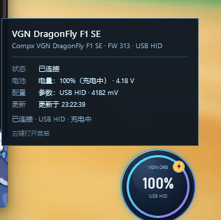
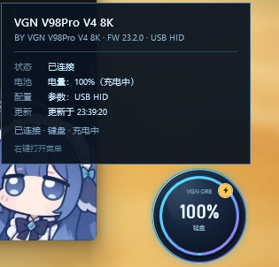

# VGN Orb

一个可以独立运行的 Windows 多设备悬浮球：常驻系统托盘，同时识别并展示最多 **6 台** 受支持设备，优先读取真实 VGN F1 SE 鼠标和 V98Pro V4 键盘电量，没有真实设备时回退到模拟设备。


## 当前状态

- 已通过公开 VGN HUB 网页驱动逆向并真机验证两种设备：
  - VGN DragonFly F1 SE：有线与 2.4G 接收器电量读取。
  - VGN V98Pro V4：有线与 2.4G 接收器电量读取。
- 已同时显示 F1 SE 和 V98Pro V4 两个真实设备。
- 最多同时显示 **6 个独立设备卡片**，布局为 **3 列 × 2 行**；设备少时窗口自动收缩。
- 每台设备独立连接、独立轮询、独立报错；一台设备休眠或断开不会影响其他设备。
- 没有检测到受支持硬件时自动显示一个模拟设备。
- 只实现经过验证的读取路径；不写入设备配置，也不实现未验证的私有配置协议。

六个设备的布局验证（使用模拟设备填充，最多 3×2）：


单设备详情仍可查看电量、电压、固件和连接状态：





## 技术栈

- C# / .NET 10
- WPF + MVVM
- CommunityToolkit.Mvvm 8.4.2
- HidSharp 2.6.4（真实 HID 传输）
- System.Text.Json
- System.Windows.Forms.NotifyIcon（仅用于系统托盘集成）

## 当前能力

- 四项目解决方案，`VGNOrb.Core` 与 `VGNOrb.Devices.Vgn` 均不依赖 WPF。
- 无边框、透明背景、圆形设备卡片。
- 多设备网格自动布局：1 个、2 个、3 个、4–6 个设备自适应列数。
- 每张设备卡片独立显示设备类型、电量、充电状态。
- 单台设备悬停显示完整设备名、固件、电压（鼠标）、参数和更新时间。
- 鼠标左键拖动整个设备网格，位置自动保存。
- `PerMonitorV2` DPI 清单；界面使用 WPF 设备无关单位。
- 系统托盘图标、设备列表、双击显示/隐藏、右键菜单。
- 托盘菜单支持刷新全部、重新发现并连接、断开全部、始终置顶和退出。
- 悬浮球右键菜单提供同样的全局操作。
- 设备轮询、UI 更新、设备生命周期相互独立。
- JSON 配置持久化，损坏的配置自动回退到默认值。
- 29 个单元测试覆盖两种真实设备协议、抓包回归、轮询和配置。

## 已验证硬件

| 设备 | VID / PID | 连接 | 验证结果 |
| --- | --- | --- | --- |
| VGN DragonFly F1 SE | `0x3554` / `0xFB51` | USB 有线 | 100%、充电中、4182 mV、FW 313 |
| VGN DragonFly F1 SE | `0x3554` / `0xFB50` | 2.4G 接收器 | 100% |
| VGN V98Pro V4 8K | `0x391D` / `0x200B` | USB 有线 | 100%、充电中、FW 23.2.0 |
| VGN V98Pro V4 8K | `0x391D` / `0x2A03` | 2.4G 接收器 | 99% |

附加兼容映射（本机未做实物验证）：

- F1 SE 备用有线 PID：`0x3554:0xF511`。
- V98Pro V4 TIMI / 接收器 PID：`0x391D:0x201C`、`0x391D:0x2A0A`。

协议细节、原始请求/响应帧和校验算法见
[`docs/vgn-hid-protocol.md`](docs/vgn-hid-protocol.md)。

## 多设备工作方式

1. 启动时从鼠标和键盘两个发现源收集所有受支持设备。
2. 按设备 ID 去重，最多取 6 台。
3. 为每台设备创建一张卡片，并创建独立的 `DevicePollingService`。
4. 所有设备并行展示；连接失败只影响当前卡片。
5. 窗口按设备数量自动调整尺寸并在需要时移回屏幕范围。
6. 没有任何真实设备时，使用一个模拟设备卡片。

这与之前“选择鼠标/键盘之一”的模式不同：现在会同时显示所有识别到的设备。

## 项目结构

```text
VGNOrb.sln
├─ src/
│  ├─ VGNOrb.Core/                 # 无 WPF 依赖
│  │  ├─ Devices/                  # IDevice / 发现接口 / 数据模型
│  │  │  └─ Mock/                  # 模拟设备与模拟发现服务
│  │  ├─ Polling/                  # 独立设备轮询服务
│  │  └─ Configuration/            # AppSettings + 原子 JSON 存储
│  ├─ VGNOrb.Devices.Vgn/          # HidSharp + 真实设备读取适配器
│  │  ├─ VgnJmProtocol.cs          # F1 SE 鼠标协议
│  │  ├─ VgnKeyboardProtocol.cs    # V98Pro V4 键盘协议
│  │  └─ Vgn*Device*.cs
│  └─ VGNOrb.App/                  # WPF 组合根、视图、视图模型、托盘服务
│     ├─ ViewModels/
│     │  ├─ OrbViewModel.cs        # 多设备编排
│     │  └─ DeviceTileViewModel.cs # 单设备独立生命周期
│     ├─ Views/
│     │  ├─ OrbWindow.xaml         # 多卡片网格窗口
│     │  └─ DeviceTile.xaml        # 单张设备卡片
│     ├─ Controls/BatteryRing.cs
│     └─ Services/
└─ tests/
   └─ VGNOrb.Core.Tests/
```

## 构建与运行

环境要求：Windows 10/11、.NET 10 SDK。

```powershell
dotnet restore VGNOrb.sln
dotnet build VGNOrb.sln -c Release
dotnet run --project src/VGNOrb.App/VGNOrb.App.csproj
```

Release 输出位于：

```text
src/VGNOrb.App/bin/Release/net10.0-windows/VGNOrb.exe
```

应用没有主窗口。启动后设备网格默认出现在主屏幕工作区右下角，托盘区出现 VGN Orb 图标。

- 1 台设备：单球窗口。
- 2 台设备：2 列。
- 3 台设备：3 列。
- 4–6 台设备：3 列 × 2 行。
- 设备数量变化时，窗口自动调整尺寸。

## 交互

| 操作 | 行为 |
| --- | --- |
| 左键拖动任意设备卡片 | 移动整个设备网格，松手后保存位置 |
| 悬停单张卡片 | 查看该设备的完整详情 |
| 悬浮球右键 → 刷新全部电量 | 刷新所有已连接设备 |
| 悬浮球右键 → 重新发现并连接 | 重新发现并重建全部设备 |
| 悬浮球右键 → 断开全部设备 | 停止轮询并释放所有设备 |
| 托盘图标双击 | 显示或隐藏悬浮球 |
| 托盘图标右键 | 查看设备列表、刷新、重连、断开或退出 |
| 托盘「设备 (N/6)」 | 查看当前最多 6 台设备的状态 |

关闭悬浮球窗口（例如 Alt+F4）会隐藏到托盘，不会退出进程。退出请使用托盘菜单的「退出 VGN Orb」。

## 配置

配置路径：

```text
%APPDATA%\VGNOrb\settings.json
```

示例：

```json
{
  "alwaysOnTop": true,
  "showOrbOnStartup": true,
  "autoConnectDevice": true,
  "preferHardware": true,
  "orbSize": 116,
  "orbLeft": null,
  "orbTop": null,
  "pollIntervalMilliseconds": 5000
}
```

- `preferHardware`: `true` 时优先真实设备，缺失时回退模拟设备；`false` 时强制模拟设备。
- `orbSize`：单张设备卡片的尺寸（不是整个窗口尺寸）。
- 窗口尺寸由设备数量自动计算；位置会自动限制在屏幕范围内。
- 尺寸限制 72–180，轮询间隔限制在 1000–60000 毫秒。

## 测试

```powershell
dotnet test tests/VGNOrb.Core.Tests/VGNOrb.Core.Tests.csproj -c Release
```

当前包含 29 个测试，覆盖：

- 鼠标真机抓包回归：请求帧、在线响应、电量响应、固件响应、校验和。
- 键盘真机抓包回归：电量查询、固件查询、响应解析、校验和。
- 电量/充电/电压数据模型。
- 模拟设备连接状态、取消连接、参数读写。
- 轮询持续运行、异常隔离、停止。
- 设备发现与异常端点。
- JSON 配置往返、损坏文件回退、参数归一化。

## 有意暂缓的部分

- **不写真实设备配置。** 所有写命令尚未独立验证，适配器只开放读取路径。
- **不支持未验证的键盘/鼠标型号、Bootloader。** 当前结论只适用于真机验证过的 PID 及网页驱动明确映射的同家族 PID。
- **不复制厂商代码。** 网页驱动只作为协议行为参考；C# 实现是独立重写的，并有真机抓包回归测试。
- 未使用 WebView、大型 UI 框架或额外的 MVVM 框架。
